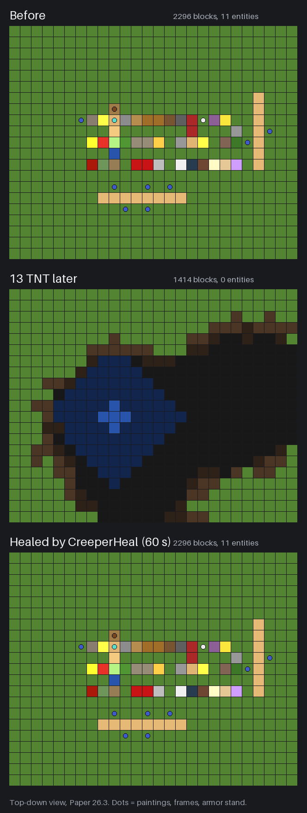

# CreeperHeal for Paper — explosions that heal themselves

A port of [nitnelave's CreeperHeal](https://github.com/nitnelave/CreeperHeal) (last
updated for Spigot 1.16) to current Paper. Creepers, TNT, ghasts and fire still wreck
things, but a minute later the damage grows back block by block — including sign text,
chest contents, doors, rails, paintings, item frames and armor stands.

## Build and install

```bash
./gradlew build     # jar in build/libs/
# or
mvn package         # jar in target/
```

Drop `CreeperHeal-9.0.0-paper.jar` into the `plugins/` folder of a Paper server
(1.21.11 or newer, including 26.x). No configuration is needed; default config files
are written on first start.

- **Gradle:** any Java 17+ runs the wrapper, which downloads Gradle and a JDK 25 to
  compile with.
- **Maven:** needs Maven and JDK 21+ installed.
- The version number and Paper API version are set in both `pom.xml` and
  `build.gradle.kts`; change both together.



The picture is rendered from a real test run on Paper 26.3: a scene with 60-odd
"awkward" blocks and 11 entities, 13 TNT, and the world 60 seconds later.

## Spec
- Builds against the Paper API (1.21.11) with Java 21; one jar runs on Paper 1.21.11
  and on 26.x.
- Explosions (creeper, TNT, TNT minecart, ghast, wither, end crystal, dragon — each
  toggleable per world) are recorded and healed after `wait-before-heal` seconds,
  block by block or all at once. Burnt blocks heal the same way.
- Everything comes back as it was: block states, block-entity data (signs, containers,
  banners, spawners, jukeboxes...), multi-block things (doors, beds, double chests,
  tall plants, extended pistons) and attached things (torches, buttons, ladders,
  lanterns, rails, crops, dripstone...). Nothing drops as an item, nothing is duplicated.
- Blocks whose support is not back yet wait and are retried. If one is still stuck
  after 150 tries, the rest of that explosion is restored in one go, supports first.
- Paintings (any size, any wall), item frames (plain and glowing, with item and
  rotation) and armor stands (pose and equipment) are put back too.
- Same commands (`/creeperheal`, `/ch`), permissions and config files as upstream, so
  an existing `plugins/CreeperHeal` folder keeps working.

## What changed from upstream 8.0.0
- `spigot-api 1.16` → `paper-api 1.21.11`, Java 6 → 21, `api-version: '1.21'`.
- Blocks are stored as full `BlockState` snapshots and restored with
  `BlockState#update`, so block-entity data survives (upstream lost sign text).
- "Which blocks hang onto this one?" is no longer three hand-kept material lists
  (which stopped at 1.16) but Paper's `BlockData#isSupported` — new blocks work
  without code changes.
- Removed every legacy `MaterialData` / raw-data call, renamed entity types
  (`PRIMED_TNT` → `TNT`...), world height no longer assumed to start at 0, sounds
  looked up in the registry, command registered through `Bukkit.getCommandMap()`
  instead of reflection on the old plugin manager.
- Wind charges (explosions that only flick switches) are ignored.
- Upstream bugs fixed on the way: stairs/trapdoors were treated as two-block-high
  and took the block above with them; armor stands blown up by TNT were lost; glow
  item frames came back as plain ones; a burnt block that could not be put back
  dropped its item every second forever.
- Also fixed in code but not exercised by the test runs: `change-stone-to-cobble`,
  `replace-grass-with-dirt`, `crack-destroyed-bricks`, `prevent-chain-reaction` and
  `replace-silverfish-blocks` had no effect upstream.

## How it was checked
Real servers (Paper 26.3 build 249 on Java 25, Paper 1.21.11 build 132 on Java 21),
driven from the console. A helper plugin dumped every block, inventory, sign and
entity in the test area before the explosion and after the heal, and the dumps
were diffed:

| Scenario | 26.3 | 1.21.11 |
|---|---|---|
| 13 TNT, block-by-block heal | identical | identical |
| Creeper, then `/ch heal world` | identical | identical |
| Wool fire, burnt blocks heal | all back | all back |
| 13 TNT, all-at-once heal | identical | not run |
| 13 TNT, then server stop (heal on shutdown) | identical except piston | not run |

A sixth run on 26.3 put a sign on a blacklisted block to force the stuck-block
fallback: it fired once, everything else healed identically, nothing was duplicated,
and the sign came back unsupported (it drops as an item when next updated).

No item drops and no errors in any run. The only differences were vanilla ones
(grass turning to dirt under blocks). On shutdown a powered piston comes back
retracted until something updates it.

**Not checked:** a real player in the world (grief warnings, teleport-when-buried,
`/ch healNear`), ghast/wither/dragon explosions, Folia.

## Assumptions
- "Paper version" means current Paper: built against 1.21.11 so the same jar also
  runs on 26.x. Older servers (1.16–1.20) are not supported; use upstream there.
- The LWC, MobArena and Factions hooks are dropped: they were compiled against
  decade-old jars checked into the repo. The config keys remain and do nothing;
  the seams are `PluginHandler` and `FactionHandler`.
- MCStats metrics are removed (the service is gone).
- `replace.yml` takes block names only (`STONE: COBBLESTONE`); the old numeric
  data values are not read.
- `performance.replace-rails-correctly` is now a no-op: rails are always put back
  without neighbour updates, which keeps the track shape.
- Version is `9.0.0-paper`; package and plugin name are unchanged so it replaces
  the old jar in place. License stays LGPL v3, credit to nitnelave and Jikoo.

## Next steps
- Re-add protection hooks for plugins that exist today (WorldGuard, GriefPrevention,
  Towny, a current Factions fork).
- Join a server with a real client and check the player-facing parts listed above.
- Folia support (region schedulers) — everything currently runs on the main thread.
- Persist pending explosions across crashes (today they are only healed on a clean
  shutdown).
- Move messages from legacy `ChatColor` to Adventure components.
